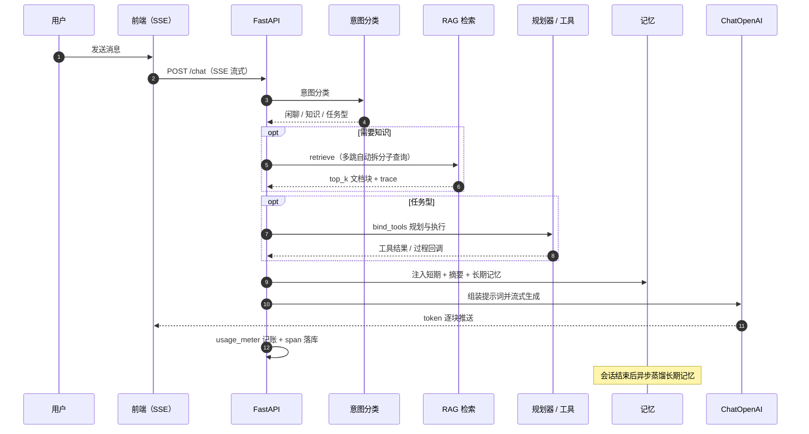

# AI 与 Agent 架构

> 本文聚焦系统最核心的技术亮点：模型接入、意图路由、Plan-and-Run 编排、工具与沙箱、记忆、多 Agent、RAG 两阶段检索，以及可观测与成本归因。

## 一、总体分层

```tree
┌────────────────────────────── 交互层 ──────────────────────────────┐
│ Agent 工作台（SSE 流式） · 报告/评估/反馈/习题 · 家长客服 · PPT 生成   │
└───────────────────────────────▲────────────────────────────────────┘
                                │ 统一流式协议（文本 + options + phase）
┌────────────────────────────── 编排层 ──────────────────────────────┐
│ 意图路由 agent_intent → 规划器 agent_planner → 记忆 agent_memory     │
│ 多 Agent 注册 agent_registry · 统一对话 agent_chat                   │
└───────────────────────────────▲────────────────────────────────────┘
                                │
┌────────────────────────────── 能力层 ──────────────────────────────┐
│ RAG 检索 · 业务工具 · 只读 SQL · Web Search · MCP · Skill 沙箱 · PPT │
└───────────────────────────────▲────────────────────────────────────┘
                                │
┌────────────────────────────── 模型层 ──────────────────────────────┐
│ LangChain ChatOpenAI（OpenAI 兼容网关）· Embeddings · 原生工具调用    │
└────────────────────────────────────────────────────────────────────┘
```

## 二、技术栈与框架定位

| 组件 | 作用 | 实现位置 |
| --- | --- | --- |
| LangChain Core | 消息协议（System/Human/AI）、流式 chunk、usage_metadata | `services/llm.py` |
| langchain-openai | `ChatOpenAI`（对话/规划）、`OpenAIEmbeddings`（向量） | `services/llm.py`、`services/rag.py` |
| 原生 Tool Calling | `model.bind_tools(tools)` 走模型 function calling | `services/llm.py::tool_step` |
| ChromaDB | 持久化向量库，集合按 embedding 指纹分片 | `services/rag.py` |
| MCP | Streamable HTTP + JSON-RPC 发现/调用外部工具 | `services/mcp_runner.py` |
| E2B / 百炼 Sandbox | Skill 脚本远程隔离执行（E2B 协议） | `services/skill_exec.py` |
| sentence-transformers | 本地 Qwen3-Embedding-0.6B 回退（可选） | `services/rag.py` |

### LangChain 与 LangGraph 结论

- **LangChain：已使用**。模型调用、消息组织、Embedding、原生工具调用均基于 LangChain 生态。
- **LangGraph：未使用（预留）**。`pyproject.toml` 的 `ai` 可选依赖声明并安装了 `langgraph>=0.2`，但应用代码没有导入；当前编排是自研 **Plan-and-Run 多轮循环**，并非 LangGraph 状态图。
- 之所以自研编排：需要与业务工具、Skill 沙箱、记忆蒸馏、用量记账、过程流式回调深度耦合，Plan-and-Run 更易控制预算、轮次与兜底策略。

> 若后续迁移到 LangGraph，可在保持 `agent_tools` 工具层不变的前提下，将 `agent_planner` 的循环替换为状态图，并接入检查点实现断点续跑。

## 三、模型接入层（`llm.py`）

- **多来源解析**：优先使用当前教师/系统在「模型配置」中解析出的网关与 Key，未配置时回退全局 `LLM_*` 环境变量；两者皆无则抛 `LLMConfigError`
- **OpenAI 兼容**：通过 `ChatOpenAI` + `base_url` 接入任意兼容网关，换厂商不改业务代码
- **流式输出**：`model.stream(...)` 逐块产出，前端 SSE 实时渲染；`_StreamSanitizer` 跨 chunk 剔除模型偶发吐出的原生工具标记，避免污染历史
- **多模态**：支持 `image_url` 内容块，视觉模型可直接读图
- **计量**：优先取 `usage_metadata` 的真实 token，缺失时按字符估算并标记 `estimated`；同时记录缓存命中 token
- **可观测**：每次调用开一个 `model` span，记录模型、耗时、输入/输出 token
- **错误友好化**：将鉴权失败、限流、超时、连接失败翻译为可读提示

## 四、意图路由（`agent_intent.py`）

对话进入编排前先做意图分类，决定是否检索、是否调用工具：

| 意图 | 含义 | 典型动作 |
| --- | --- | --- |
| `chitchat` | 闲聊/问候 | 直接回答 |
| `knowledge_qa` | 制度/流程问答 | 触发 RAG 检索 |
| `business_data` | 排课、考勤、学员等业务查询 | 规划业务工具 |
| `ppt_task` | PPT 生成/编辑 | Skill + 沙箱 |
| `document_task` | 文档生成 | Skill/文档工具 |
| `mcp_task` | 外部工具/数据源 | MCP 调用 |
| `mixed` | 混合意图 | 检索 + 工具 |

- **规则优先**：关键词与正则快速判定，低延迟、可解释
- **LLM 兜底**：规则不确定时用低温模型分类，返回 `needs_rag`、`task_kind`、`confidence`
- 分类结果驱动后续「是否检索、注入哪些上下文、是否进入工具规划」

## 五、编排器（`agent_planner.py`）

核心是 **Plan-and-Run 多轮循环**：

```text
构建消息(系统 + 最近对话摘要 + 当前问题 + 工具清单)
  → 模型 bind_tools 返回 tool_calls
  → 逐个执行工具(去重、记录 span、实时回调前端)
  → 工具结果作为 HumanMessage 追加
  → 循环直到模型不再调用 / 达到轮次·次数·时间预算
  → 汇总为上下文块交给生成模型作答
```

关键工程点：

- **预算控制**：轮次上限、工具调用上限、总耗时预算均可配置（`AGENT_TOOL_*`）
- **去重**：同名同参调用只执行一次
- **过程可观测**：每个工具执行前后回调前端，用户能看到「执行到哪一步」
- **防零工具**：规划器未产出调用时，按关键词启发式兜底；业务问题不允许「零工具」回答
- **Skill 兜底**：任务型请求若模型只读不执行，自动补跑入口脚本或自动出片，避免「说了没做」
- **失败不中断**：单工具异常记录后继续，整体降级而非报错
- **上下文延续**：多轮续作会带上最近对话摘要，避免「继续用深靛」这类短确认句被当成新任务

## 六、工具与沙箱

### 工具清单（`agent_tools.py`）

| 类别 | 工具示例 | 说明 |
| --- | --- | --- |
| 业务查询 | 我的排课、教学统计、班级/学员、学员评估 | 按当前教师作用域过滤 |
| 只读 SQL | `sql_list_tables`、`sql_describe_table`、`sql_query` | 白名单 + 只读 + 限制 |
| 知识检索 | `search_knowledge` | 走 RAG 两阶段检索 |
| 联网搜索 | `web_search` | 仅用于公开外部信息 |
| Skill | `run_skill_script`、读写/删除/列目录 | 本地或远程沙箱执行 |
| PPT | 生成/插页/删页/构建 | 写 SVG 页后 build 出片 |

### 只读 SQL（`agent_sql.py`）

- 仅允许 `SELECT` 或 `WITH`，禁止写操作与多语句
- 表白名单 + 作用域表强制注入教师过滤条件
- 敏感列脱敏：`password_hash`、`share_token`、`ai_draft`、`phone`
- 自动补 `LIMIT`（默认 50 行），语句超时 5 秒，独立只读引擎

### Skill 沙箱（`skill_exec.py`）

- 允许脚本类型：`.py` / `.js` / `.sh`
- 单次超时 300 秒，输出上限 64KB
- 本地执行与远程沙箱（E2B 协议 / 百炼 Sandbox）二选一
- 会话级 `projects/` 工作区隔离，产物自动回传下载链接

### MCP（`mcp_runner.py`）

- Streamable HTTP + JSON-RPC：`tools/list` → 规划 → `tools/call`
- 单次最多 3 次调用、15 秒超时、结果与展示长度均有上限
- 支持鉴权头与连接测试

### Web Search（`web_search.py`）

- 仅用于公开外部事实，提示词中明确禁止回答内部业务问题
- 与内部数据/知识库冲突时，一律以内部为准

## 七、记忆（`agent_memory.py`）

| 机制 | 当前默认 | 作用 |
| --- | --- | --- |
| 短期窗口 | 最近 10 轮 | 保证对话连贯 |
| 摘要触发 | 30 条消息 | 超长时压缩为摘要 |
| 长期记忆 | Top-K 8 | 偏好/事实/经验检索 |
| 记忆衰减 | 每 20 次 | 降低过期记忆权重 |
| 工作记忆 | 任务级 | 识别「新任务/继续/完成」并切换 |

长期记忆由 LLM 异步蒸馏（`distill_async`）产生，不阻塞主对话。

## 八、多 Agent（`agent_registry.py`）

- 注册表定义 Agent（如智能助手、报告 PPT、家长会 PPT），每个 Agent 有阶段、提示词与能力
- **能力解析**：`effective_skill_ids` 合并「Agent 绑定 ∪ 全局默认」，未勾选的 Skill 不进清单、不可被调用
- **默认供给**：新用户自动供给默认 PPT Agent
- **统一协议**：`agent_chat.py` 把不同 Agent 抽象为「阶段 + 可执行 options」，前端渲染为选项气泡、一键推进

## 九、家长客服的权益与风控

家长客服按「权益 + 行为」双维度治理，避免把在读学员家长误伤成 3 次体验：

| 维度 | 规则 |
| --- | --- |
| 身份识别 | 家长账号为正常入口；学员端不再展示客服（前端菜单与路由双拦截） |
| 权益判定 | 任一关联学员课时 > 0 → 完整权益；课时为 0 / 未绑定学员 → 体验额度 |
| 日配额 | 只统计「AI 生成的回答」（`billable`）；查课时/课表等工具查询、寒暄、菜单、风险转人工不扣次数 |
| 体验额度 | 匿名与无课时用户默认 3 次/日；提示续费或转人工 |
| 在读额度 | 默认 50 次/日，0 = 不限；异常行为由突发频控拦截 |
| 突发频控 | 同一身份 10 条/60 秒（`PARENT_CHAT_BURST_PER_MIN` 可调），超限 429 |
| 风险兜底 | 高风险词命中直接转人工，不调用模型、不消耗额度 |

**模型配置入口（唯一）**：管理员在「设置 → 模型配置 → 家长客服 · 共享模型」统一配置对话模型、专属 Embedding、共享 Rerank；其中 Embedding / Rerank 均提供「检查」连通性按钮。家长客服已从「各模块选用模型」移出，避免两处重复配置；底层仍保留「共享 → 模块映射 → 系统默认」的兼容回退。

## 十、RAG 技术要点（`rag.py`）

- **两阶段检索**：向量过召回 `top_k*5` → Rerank 精排到 `top_k`；未配置 Rerank 时等价单层向量召回
- **Rerank 熔断**：连续失败 3 次触发 60 秒熔断，直接回退向量序，避免每次等超时
- **Embedding 指纹分片**：集合名 `knowledge__{fingerprint}`，换模型即落新集合，杜绝不同向量空间串味/维度错
- **语义分块**：512 字、100 重叠，块内保留父文本（parent-child）提升回答完整度
- **批量接入**：Agent 工作台支持多文件批量上传（拖拽/多选、单批 ≤10 个、单文件 ≤20MB），按 SHA-256 跳过同内容文档，避免重复向量化
- **索引档案**：索引完成时冻结本次分块参数、Embedding 模型/指纹、集合名、向量维度与块长分布，后台「知识资产 → 文档接入」可逐篇观测，换配置后可重索引刷新
- **家长独立域**：家长客服可配置专属 Embedding，落到独立集合，只索引家长可见文档
- **可观测**：每次检索记录召回、重排、耗时、命中，供评测与调参

详见「后台管理（RAG）」与「评测数据规格」。

## 十一、可观测与成本

- **Trace/Span**（`agent_ops.py`）：模型、检索、工具、Skill 均开 span，记录状态、耗时、token、摘要
- **用量记账**（`usage_meter.py`）：调用完成异步落账，模块归因由 `llm_context` 注入
- **计价**（`pricing.py`）：版本化价格表，按调用时间匹配当时生效价格
- **评测成本**：裁判与生成调用归因 `rag_eval`，可在用量看板筛选

## 十二、一次对话的时序



文本版步骤：

```text
用户消息
  → 意图分类
  → (需要时) RAG 检索 + (任务型) 工具规划
  → 记忆块注入（短期 + 摘要 + 长期）
  → LangChain ChatOpenAI 流式生成（SSE 逐块）
  → 工具执行过程实时回调（可选）
  → 用量记账 + span 落库
  → 会话结束后异步蒸馏长期记忆
```

## 十三、扩展指南

1. **新增业务工具**：在 `agent_tools.py` 增加实现与 `TOOLS_SCHEMA` 条目，登记权限与作用域
2. **新增 Agent**：在 `agent_registry.py` 注册阶段/提示词/能力，`agent_provision` 按需供给
3. **接入外部工具**：配置 MCP 端点，规划器会自动发现 `tools/list`
4. **新增 Skill**：打包为 ZIP（含 `SKILL.md` 与入口脚本），沙箱执行并回传产物
5. **新增 AI 场景**：务必注入 `llm_context` 模块与归属，否则用量会落入未知模块
