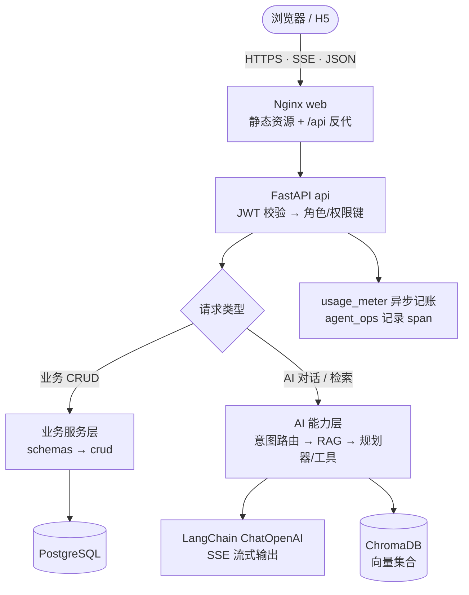

# 系统架构

## 技术栈总览

| 层 | 技术 | 用途 |
| --- | --- | --- |
| 前端 | Vue 3 + TypeScript + Vite | 管理端 + 客户端 H5 |
| 状态/路由 | Pinia + Vue Router | 登录态、权限守卫、模块导航 |
| 后端 | FastAPI + Pydantic | REST API、依赖注入、鉴权 |
| 数据访问 | SQLAlchemy 2.x + Alembic | ORM、迁移、幂等补列兜底 |
| 数据库 | PostgreSQL 16 | 业务数据持久化 |
| **模型接入** | **LangChain（langchain-core / langchain-openai）** | **ChatOpenAI、OpenAIEmbeddings、消息协议、原生 function calling** |
| **向量检索** | **ChromaDB（PersistentClient）+ OpenAIEmbeddings** | **系统级向量库，按 embedding 指纹分片** |
| **Agent 编排** | **自研 Plan-and-Run + 原生 Tool Calling** | **多轮工具规划、记忆注入、流式执行** |
| **工具协议** | **MCP（Streamable HTTP / JSON-RPC）** | **接入外部工具与数据源** |
| **沙箱执行** | **E2B 2.31（百炼 Sandbox，E2B 协议）** | **Skill 脚本远程执行** |
| 本地向量（可选） | sentence-transformers（Qwen3-Embedding-0.6B） | 开发机回退，生产镜像不装 |
| 文档产物 | python-pptx / pypdf / python-docx / reportlab | PPT、PDF、DOCX 生成 |
| 部署 | Docker Compose + Nginx | web/api/db 三服务，命名卷持久化 |

## 关于 LangChain 与 LangGraph 的定位（重要）

| 框架 | 是否使用 | 说明 |
| --- | --- | --- |
| **LangChain** | **是** | `llm.py` 用 `ChatOpenAI` 统一接入 OpenAI 兼容网关，用 `langchain_core.messages`（SystemMessage / HumanMessage）组织上下文，`tool_step` 通过 `model.bind_tools(...)` 使用**原生 function calling**；`rag.py` 用 `OpenAIEmbeddings` 生成向量；评测/裁判同样复用 LangChain 消息协议 |
| **LangGraph** | **否（预留）** | `pyproject.toml` 的 `ai` 可选依赖声明了 `langgraph>=0.2` 并随镜像安装，但**应用代码当前未导入 LangGraph**。Agent 编排由 `services/agent_planner.py` 的 **Plan-and-Run 循环**实现，而非 LangGraph 的状态图 |
| ChromaDB | 是 | 直接使用 `chromadb.PersistentClient`，非 LangChain VectorStore 封装 |
| MCP | 是 | `services/mcp_runner.py` 以 Streamable HTTP + JSON-RPC 调用外部 MCP 工具 |

> 结论：系统**深度使用了 LangChain**，但**没有使用 LangGraph**。LangGraph 作为后续「图编排 / 持久化检查点 / 多智能体协作」的预留在依赖中，避免当前文档误标。若后续引入，应在 `ai-agent.md` 与本表同步更新。

## 系统分层

```tree
┌──────────────────────────────────────────────────────────────────┐
│ 浏览器：管理端（教师/教务/管理员）   ·   客户端 H5（家长/学员）        │
└───────────────▲────────────────────────────────▲─────────────────┘
                │ HTTPS / SSE 流式 / JSON          │
        ┌───────┴────────┐                ┌───────┴─────────┐
        │ Nginx (web)    │───────────────▶│ FastAPI (api)    │
        │ 静态资源 + /api │                │ uvicorn :8000    │
        └────────────────┘                └───────┬─────────┘
                                                  │
              ┌───────────────────────────────────┼─────────────────────────┐
              │                                   │                         │
      ┌───────▼────────┐                ┌─────────▼────────┐        ┌───────▼────────┐
      │ 业务服务层      │                │ AI 能力层         │        │ 数据层          │
      │ 学员/排课/反馈  │                │ 意图路由/规划器    │        │ PostgreSQL     │
      │ 报告/评估/财务  │                │ LangChain 模型     │        │ SQLAlchemy     │
      └───────┬────────┘                │ RAG/记忆/工具      │        └────────────────┘
              │                         └─────────┬────────┘
              │                                   │
      ┌───────▼────────┐                ┌─────────▼─────────────────────────────┐
      │ 用量记账/审计   │                │ ChromaDB · Embedding · Rerank · MCP    │
      │ agent_ops span │                │ E2B/百炼 Sandbox · Web Search          │
      └────────────────┘                └───────────────────────────────────────┘
```

## 仓库目录

```tree
Child_Code/
├── backend/
│   ├── app/
│   │   ├── api/            # 路由与依赖（routers/*、deps）
│   │   ├── core/          # 配置、数据库、安全、schema_ensure、ratelimit
│   │   ├── crud/          # 数据访问层
│   │   ├── models/        # SQLAlchemy 模型（含 agent_trace、usage）
│   │   ├── schemas/       # Pydantic 校验
│   │   ├── services/      # 领域与 AI 服务（见下表）
│   │   └── main.py        # 应用入口与路由挂载
│   ├── alembic/           # 数据库迁移
│   ├── evals/             # 检索评测指标（hit@k / MRR / recall）
│   ├── scripts/           # 运维与一次性脚本
│   └── tests/             # pytest 用例
├── frontend/
│   └── src/
│       ├── api/           # axios 客户端与接口封装
│       ├── stores/        # Pinia（auth、主题、任务）
│       ├── router/        # 路由与守卫
│       ├── layouts/       # 管理端/客户端布局
│       ├── views/         # 页面（按业务分目录）
│       ├── utils/         # 工具（markdown 渲染等）
│       └── docs/          # 应用内开发文档（Markdown）
├── docs/                  # PRD、ADR、术语表、导入规格、截图
├── deploy/                # 部署相关（nginx 等）
└── docker-compose.yml
```

## AI 服务清单

| 文件 | 职责 |
| --- | --- |
| `services/llm.py` | 模型接入、流式输出、原生工具调用、token 计量、错误友好化 |
| `services/llm_context.py` | 请求级上下文（模块/归属），供记账与追踪 |
| `services/agent_intent.py` | 意图分类（规则 + LLM），决定是否检索与走哪条链路 |
| `services/agent_planner.py` | Plan-and-Run 多轮工具规划与执行（含兜底） |
| `services/agent_tools.py` | 业务工具与工具 Schema、只读 SQL、Skill/PPT 工具 |
| `services/agent_memory.py` | 短期窗口、摘要、长期记忆、工作记忆、异步蒸馏 |
| `services/agent_registry.py` | 多 Agent 注册与能力/Skill 解析 |
| `services/agent_chat.py` | 统一流式对话协议（阶段 + 可执行 options） |
| `services/mcp_runner.py` | MCP Streamable HTTP 工具发现与调用 |
| `services/skill_exec.py` | Skill 脚本本地/远程沙箱执行（E2B/百炼） |
| `services/agent_sql.py` | 只读 SQL 校验、敏感列脱敏、行数与超时限制 |
| `services/rag.py` | Embedding、Chroma、两阶段检索、Rerank 熔断 |
| `services/rag_judge.py` / `rag_evaluation.py` | LLM 裁判与评测运行 |
| `services/usage_meter.py` / `pricing.py` | 异步用量记账与版本化计价 |
| `services/agent_ops.py` | Trace/Span 观测 |

> 深入原理见 **「AI 与 Agent 架构」** 文档（`/docs/ai-agent`）。

## 请求链路



### 普通业务请求

```text
axios(/api) → JWT 校验 → 角色/权限键 → crud → PostgreSQL → 响应
```

### AI 对话请求

```text
SSE 请求 → 意图分类(agent_intent) → [RAG 检索] + [业务工具规划(agent_planner)]
        → 记忆注入(agent_memory) → LangChain ChatOpenAI 流式生成
        → 前端逐块渲染 → usage_meter 异步记账 + agent_ops 记录 span
```

### 检索请求

```text
query → Embedding → Chroma 向量过召回(top_k*5) → [Rerank 精排] → top_k
      → trace 记录召回/耗时/命中 → 注入提示词
```

### 评测请求

```text
评测集 → 逐条运行(检索 off/on) → 生成回答 → LLM 裁判 → 指标聚合 → Bad Case 复核
```

## 关键设计

- **幂等补列 `schema_ensure`**：启动时对已知表做 `ADD COLUMN IF NOT EXISTS` 兜底，旧库可直接运行；正式变更仍以 Alembic 为准
- **统一 LLM 上下文 `llm_context`**：为一次业务请求注入模块与归属，供记账、trace 与成本归因
- **异步用量记账 `usage_meter`**：调用完成后异步落账，失败不阻断业务
- **原生工具调用**：用 LangChain `bind_tools` 走模型原生 function calling，规划器负责多轮循环与去重
- **防零工具回答**：规划器未产出调用时按关键词启发式兜底，业务问题不允许「零工具」作答
- **RAG 可观测**：检索链路记录 trace，评测与路由调参共用同一套指标
- **文档即代码**：应用内文档以 Markdown 存放于 `src/docs/`，与代码同仓同版本

## 部署拓扑

| 组件 | 服务 | 端口 | 说明 |
| --- | --- | --- | --- |
| web | Nginx | 80（宿主 8080） | 托管前端产物，`/api` 反代到 api |
| api | uvicorn | 8000 | FastAPI 应用，含 AI 依赖 |
| db | PostgreSQL | 5432 | 持久化数据，命名卷保存 |

> `backend` 镜像以 `uv sync --extra ai` 安装 LangChain/Chroma 等 AI 依赖；生产敏感配置通过 `.env.prod` 注入，不进入版本库。
