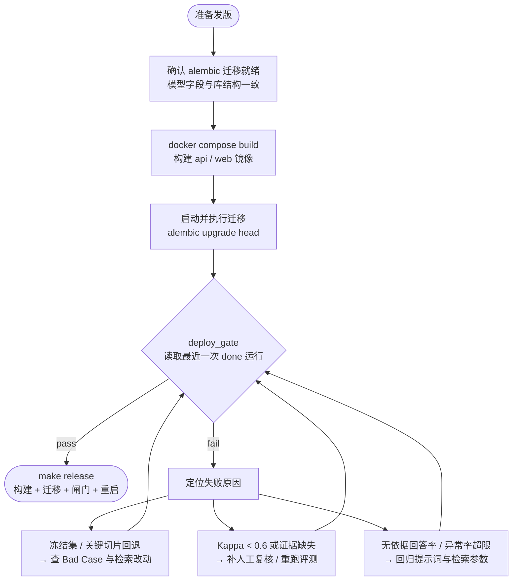

# 部署与运维

## 环境要求

- Docker 与 Docker Compose（生产推荐）
- 本地开发：Python ≥ 3.12 + uv、Node ≥ 18、PostgreSQL

## 容器部署

```bash
# 1. 准备生产环境变量（含数据库口令，勿提交）
cp .env.prod.example .env.prod   # 按需创建并填写 POSTGRES_PASSWORD 等

# 2. 构建并启动
docker compose up -d --build

# 3. 查看状态与日志
docker compose ps
docker compose logs -f api
```

| 服务 | 说明 |
| --- | --- |
| `web` | Nginx，托管前端产物并反代 `/api` |
| `api` | FastAPI（uvicorn） |
| `db` | PostgreSQL，数据存于命名卷 |

## 发布与评测闸门

发版前先通过评测闸门（判据：冻结集 / 关键用例切片无回退，无依据回答率与检索异常率未超限；开启答案评测时还要求回答、校准与基线证据齐备）：



- 手动校验：`python -m scripts.deploy_gate --set-name <评测集名>`（镜像内需用 `.venv` 解释器）
- `make release` 固定启用 `--require-answer --require-calibration --require-baseline` 证据校验，历史运行缺少对应数据时会直接拒绝发版


> 前端产物更新后需重新构建 `web` 镜像：`docker compose up -d --build web`。

## 数据库迁移

```bash
# 在 backend 目录
uv run alembic upgrade head
```

- 正式变更以 Alembic 迁移为准
- `schema_ensure` 在启动时做 `ADD COLUMN IF NOT EXISTS` 兜底，保证旧库可运行，但不能替代迁移
- 迁移前务必备份数据库

## 备份与恢复

```bash
# 备份
docker compose exec db pg_dump -U <user> <db> > backup_$(date +%F).sql

# 恢复
docker compose exec -T db psql -U <user> <db> < backup_2026-06-16.sql
```

建议每日自动备份并异地留存，定期演练恢复。

## 健康检查与日志

- 健康检查：`GET /api/health`
- 应用日志：`docker compose logs -f api`
- 关注项：5xx 比例、LLM 超时、用量记账失败、索引任务堆积

## 排障 FAQ

| 现象 | 排查方向 |
| --- | --- |
| 登录后仍 401 | 令牌过期/密钥不一致；检查 `SECRET_KEY` 与前端时钟 |
| 页面 403 | 角色或权限键不足；核对权限管理配置 |
| 评测 hit@k 全 0 | `relevant` 标题与知识库不一致 |
| 知识库检索无结果 | 索引未完成、相似度阈值过高、文档未发布 |
| 用量总额偏低 | 存在未定价模型或记账失败，查看对账页 |
| 前端改动未生效 | 未重建 web 镜像或浏览器缓存 |
| 评测成本异常 | 裁判调用过多，缩小样本并监控 `rag_eval` |

## 安全清单

- `.env.prod`、模型 Key、数据库口令不入库、不写日志
- 生产强制修改默认口令与 `SECRET_KEY`
- 权限最小化：敏感模块默认关闭，按岗位开启
- 定期升级依赖并审计漏洞
- 备份加密存储，恢复演练留痕
- 高影响操作开启二次确认与审计
