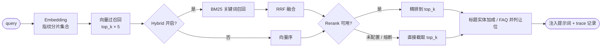

# 后台管理（RAG）

后台管理模块位于 `/rag/*`，为上层业务与 AI 能力提供知识资产、检索质量与可观测性支撑。全部子页仅管理员可见，接口侧按 `rag_*` 权限键逐项校验。

## 子页导航

| 子页 | 路由 | 作用 |
| --- | --- | --- |
| 总览 | `/rag/overview` | 运行概况、关键指标、健康与成本入口 |
| 知识资产 | `/rag/assets` | 文档上传、索引、可见性与清理 |
| 路由测试 | `/rag/routes` | 检索参数调试（top_k、相似度、重排） |
| 评测 | `/rag/eval` | 用例导入、离线/在线对比、Bad Case |
| 设置 | `/rag/settings` | 默认检索与评测策略配置 |
| 检索追踪 | `/rag/traces` | 单次检索链路明细与耗时 |
| 任务监控 | `/rag/runs` | 索引/评测等异步任务状态 |
| 会话观测 | `/rag/sessions` | 会话级检索与回答回放 |
| 家长会话 | `/rag/parent-sessions` | 家长侧服务会话观测 |

## 知识资产

- **上传与索引**：Agent 工作台「我的知识库」支持**批量上传**（单次最多 10 个文件、单文件 ≤ 20MB，可拖拽/多选），同内容文件按 SHA-256 自动跳过；索引任务异步执行，状态可在任务监控查看
- **索引档案**：文档详情展示索引快照——源文件大小、原文字符数、分块参数（chunk_size / overlap / 父子切分）、分块数、块长分布、估算 Tokens、Embedding 模型/网关/指纹、Chroma 集合、向量维度与首块向量样例；历史文档无快照时按当前配置实时统计并标记
- **可见性**：文档按业务域组织，检索仅返回当前上下文允许的资产
- **清理**：删除文档会联动清理分片与向量，操作前需二次确认并提示影响范围
- **重索引**：模型或分片策略变更后需重索引，建议在低峰期执行；重索引完成后会刷新该文档的索引档案

## 检索路由与调参

| 参数 | 含义 | 调参建议 |
| --- | --- | --- |
| `top_k` | 最终返回条数 | 从 3~5 起，按召回质量微调 |
| `min_similarity` | 相似度下限 | 过高会漏召回，过低引入噪声 |
| `per_doc_cap` | 单文档最大命中数 | 避免单一文档霸屏 |
| `rerank_oversample` | 重排前的过采样倍数 | 提升重排收益，注意耗时 |

路由测试页可即时对比不同参数下的召回结果，参数保存后作为该场景默认值。

### Hybrid 灰度步骤（Dense → Hybrid）

正式 Hybrid = 向量召回 + BM25 关键词 + RRF 融合；`keyword_fallback` 只是向量失败时的兜底，两者不要混为一谈。灰度建议按路由逐个开：

1. 评测页对同一评测集先跑 `dense` 基线、再跑 `hybrid`（同环境同参数），确认 hit@3/MRR 不降且冻结集切片无回退；
2. 后台「检索路由」给单个路由设置 `hybrid_enabled=true`（写入 `route_overrides.<route>.hybrid_enabled`），先选影响面小的路由；
3. 观察「链路」页 trace 的 `retrieval_mode` 分布（`hybrid` vs `vector`）与零召回率、P95 耗时，稳定 1~2 天后扩大范围；
4. 出问题回滚：把该路由 override 清掉即回全局默认，无需发版；评测侧可用 `dense` 强制基线复现对比。

## 检索技术实现

- **两阶段检索**：向量先过召回 `top_k*5`，再由 Rerank 精排到 `top_k`；未配置 Rerank 时等价单层向量召回
- **标题实体加成（默认 0.12）**：具体制度文档标题与 query 有字符 bigram 重叠时轻量加分，FAQ 大文档不参与，避免“GESP 报考、退费流程、教师评估”等问题永远被 FAQ 压住
- **FAQ 并列让位（默认 0.01）**：FAQ 排 top1 且与具体制度文档分差极小时，让具体文档优先；差距明显则保持 FAQ
- **多跳问题（自动）**：`retrieve(..., multi_query="auto")` 是默认模式。只把长度 ≥8 的并列/多问句子句当作独立意图（“真的假的”“那银牌呢”这类短追问会被忽略）；先跑 baseline，仅当 top1/top2 分差 ≤0.15、排序本身不自信时才拆分子查询，各自检索后按文档级 RRF 融合。需要强制多路时仍可传 `multi_query=True`
- **Rerank 熔断**：连续失败达阈值后短路一段时间，直接回退向量序，避免每次查询都等超时
- **Embedding 指纹分片**：集合名带 embedding 指纹（如 `knowledge__{fingerprint}`），换模型即落新集合，避免不同向量空间串味或维度不匹配
- **语义分块**：定长窗口 + 重叠，并保留父文本（parent-child），提升回答完整度
- **家长独立域**：家长客服可配置专属 Embedding，落到独立集合，仅索引家长可见文档
- **可观测**：每次检索记录召回、重排、耗时与命中，评测与调参共用指标

## 评测

评测子页支持用例批量导入、从分片生成候选用例、离线/在线（检索开关）对比与 Bad Case 复核。导入支持多文件选择与拖拽，可混合 JSONL / JSON / CSV；系统先解析预览（有效条数 / 解析失败明细），确认后再入库，并默认按 `query` 去重。导入格式、字段定义与合规要求见 **「评测数据规格」**（`/docs/rag-eval-spec`）。

勾选「答案质量评测」后可分别选择生成模型与评测模型；两者必须不同，模型来自评测集 owner 在「设置 → 模型配置」中的已配置模型。每次运行会记录模型快照，便于回归对比与成本追溯。

评测会调用 LLM 作为裁判，相关调用归因到 `rag_eval` 模块，计入用量与成本。用例列表支持分页（默认 20 条/页），批量导入后按页查看，避免大数据量一次性渲染。

用例支持行内编辑（补标 relevant、调整可答性/分层/关键度）：relevant 变化且未显式选择可答性时会按标注自动推导，避免「不可答 + 有相关标注」的矛盾数据。评测结果逐条支持「详情」展开：裁判五维评分（忠实/相关/完整/逻辑/正确）与理由、生成回答、引用编号校验、关键词缺失清单，用于定位单条 Bad Case 是检索问题还是答案问题；「裁判分」列直接展示各维度分数，便于挑出 completeness 最低的用例人工复核。运行详情还支持「与运行对比」：选择同评测集另一条已完成运行（如 dense 基线 vs hybrid），并排显示 hit@3/hit@1/MRR/冻结切片/完整性/无依据率/Kappa 等 11 项差值与红绿标记，跨运行 A/B 不必再用命令行。冻结集（`split=frozen`）与关键用例（`critical`）单独出切片指标，是部署闸门的判据。答案评测开启后可逐条做人工复核打分，与 LLM 裁判分数计算二次加权 Cohen's Kappa；样本 ≥10 对且 Kappa <0.6 时闸门判 fail（自动评测结论不可信）。部署前用 `python -m scripts.deploy_gate --set-name <评测集名>` 强制校验，详见部署文档。

运行中会实时显示阶段与进度（关闭重排检索 / 开启重排检索 / 生成并评判答案），刷新或重新进入页面会自动续显正在运行的评测。检索指标仅统计可答用例；不可答与未标注用例单列，不拉低 hit@k / MRR。`relevant` 支持「文档标题-板块/章节」写法，指标计算时会按实际检索到的文档标题自动归一。指标页同时展示文档级 Context Precision / Context Recall，便于判断是「没召回」还是「排序低」。

答案质量页新增「不可答拒答率」：回答中出现「文档未提供 / 不知道 / 无法回答」等明确拒答表达即计为已拒答；可答用例应保持 0%，不可答用例应尽量接近 100%。历史评测结果中的 `relevant` 如明显漏标 FAQ 等大文档，可运行 `python -m scripts.audit_eval_labels --run-id <run_id>` 做内容核验，确认后加 `--apply` 写回并记审计日志。

## 可观测性

- **切换检索观测**：每个请求携带检索开关状态，便于对比开关前后指标
- **单维检索快照**：记录召回、重排、耗时与命中，支撑调参与回归
- **任务与回放**：任务状态可追踪，会话可回放以定位线上问题

## 权限键映射

| 子页 | 查看键 | 操作键 |
| --- | --- | --- |
| 总览 | `rag_overview_view` | — |
| 知识资产 | `rag_assets_view` | `rag_assets_reindex`、`rag_assets_delete`、`rag_assets_sweep` |
| 路由测试 | `rag_routes_view` | `rag_routes_save`、`rag_routes_test` |
| 评测 | `rag_eval_view` | `rag_eval_set_create`、`rag_eval_case_add` |
| 检索追踪 | `rag_traces_view` | — |
| 任务监控 | `rag_runs_view` | — |
| 会话观测 | `rag_sessions_view` | — |
| 家长会话 | `rag_parent_sessions_view` | — |
| 设置 | `rag_settings_view` | `rag_settings_save` |

> 管理员/教务默认放行；教师需被显式授予对应键，前后端同时校验。

## 运维建议

1. 变更模型或分片策略前先备份向量数据，重索引安排在低峰期
2. 调参遵循「先召回后重排」：先保证 `top_k` 与 `min_similarity` 召回，再调重排
3. 评测集与知识库标题保持同步，避免 hit@k 因标题不一致失真
4. 关注用量看板中 `embedding`、`rerank`、`rag_eval` 的成本占比，异常增长及时排查
